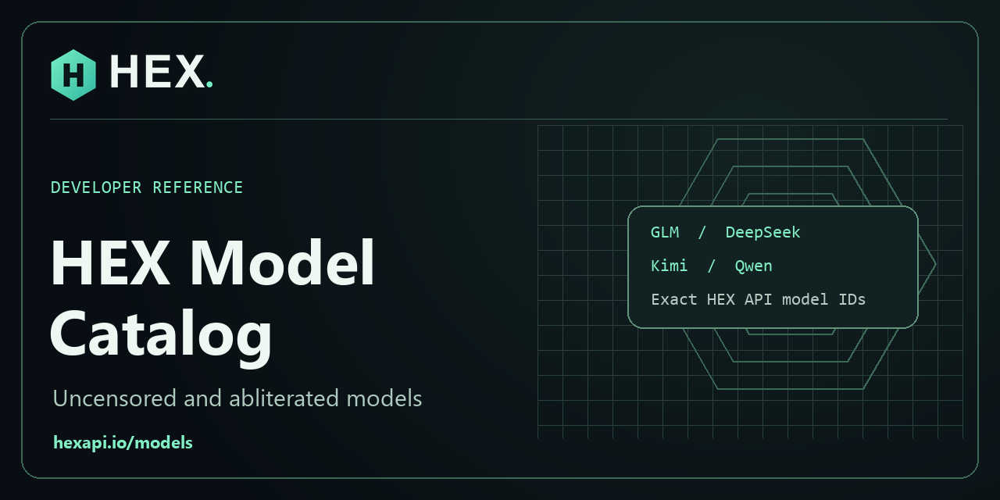

# HEX Model Catalog

Browse every model currently available through the HEX AI API. Use the exact model ID with your HEX key, then check pricing and service status before you run a workload.

[Uncensored and abliterated models](UNCENSORED-MODELS.md) · [All active models](MODEL-INDEX.md) · [Machine-readable catalog](models.json) · [Live pricing](https://hexapi.io/pricing) · [Service status](https://hexapi.io/status)

## AI jailbreak, uncensored, and abliterated models

Browse the [Uncensored and Abliterated lineup](UNCENSORED-MODELS.md) to compare available HEX model IDs across GLM, DeepSeek, Kimi, and Qwen. The [model variants guide](JAILBREAK-AND-MODEL-VARIANTS.md) explains **AI jailbreak**, **LLM jailbreak**, prompt injection, and why model labels describe variants with different behavior.

## Start with an integration

| Task | Guide |
| --- | --- |
| Send an OpenAI-compatible chat completion | [HEX API Quickstart](https://github.com/hexapi-io/hex-api-quickstart) |
| Use GPT with Responses | [GPT models guide](GPT-GUIDE.md) |
| Use Claude with Messages | [Claude models guide](CLAUDE-GUIDE.md) |
| Turn a bug report into a JSON ticket | [GLM 5.3 Abliterated API guide](https://github.com/hexapi-io/glm-5.3-abliterated) |
| Stream a release checklist in Node.js | [DeepSeek V4 Pro Uncensored API guide](https://github.com/hexapi-io/deepseek-v4-pro-uncensored) |
| Work in a local project | [HEX for OpenCode Desktop](https://github.com/hexapi-io/hex-opencode-setup) |
| Set up other coding tools | [SDK and IDE integration guides](INTEGRATIONS.md) |

## Catalog and reference

- [API formats and model availability](API-FORMATS.md)
- [Usage, token pricing, and troubleshooting](BILLING-AND-TROUBLESHOOTING.md)
- [Model behavior evaluation](MODEL-EVALUATION.md)
- [Text index of HEX resources](llms.txt)
- [Catalog updates](CHANGELOG.md)
- [Contributing corrections](CONTRIBUTING.md)
- [Security reports](SECURITY.md)

Run `node sync-models.mjs` with Node.js 22 or later to regenerate the index, the Uncensored and Abliterated list, the JSON snapshot, and individual model pages. The **Model catalog** workflow checks the live catalog daily and opens or updates a draft pull request when the generated files change. See [Contributing](CONTRIBUTING.md) for checks and capability updates.

Model names belong to their respective owners.

## Image and video models

HEX supports image creation and editing, text-to-video, and reference-based video on supported models. To inspect the operations, inputs, and prices available to your account, send an authenticated `GET /v1/media/catalog` request.

[Image guide](https://hexapi.io/ai-image-generator) · [Video guide](https://hexapi.io/ai-video-generator) · [Showroom](https://hexapi.io/app/chat?showroom=1)
